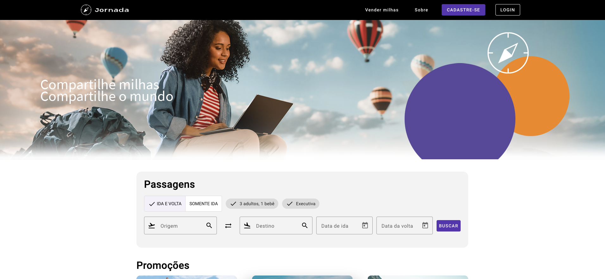

# 🎭 Dominando o Playwright

Testes **end-to-end (E2E)** com **Playwright + TypeScript** em uma aplicação Angular de busca e compra de passagens aéreas (Jornada Milhas).

O objetivo deste projeto é validar o sistema **do jeito que uma pessoa usuária usa**: abrindo o navegador, clicando, preenchendo formulários e conferindo o que aparece na tela.



---

## 🧪 O que é testado

| Spec | Cenários |
|---|---|
| [`visitarPaginaInicial.spec.ts`](e2e/visitarPaginaInicial.spec.ts) | A home carrega com o título correto e as seções de Passagens, Promoções e Depoimentos visíveis |
| [`fazerLogin.spec.ts`](e2e/fazerLogin.spec.ts) | Login com sucesso · erro com e-mail/senha inválidos · validação de campos obrigatórios |
| [`jornadaBuscarPassagens.spec.ts`](e2e/jornadaBuscarPassagens.spec.ts) | Jornada completa de busca: somente ida, passageiros (adultos, crianças e bebês), origem, destino e data, validando o card de resultado |

Os testes rodam em **Chromium** e **WebKit (Safari)**.

---

## 📚 O que aprendi

### 1. Fundamentos do Playwright
- Instalação e configuração do `playwright.config.ts` (`testDir`, `baseURL`, `projects`, `reporter`, `trace`).
- Estrutura de testes com `test.describe` e `test`.
- O ciclo **ação → asserção**: `page.goto()`, `click()`, `fill()`, `press()`, `blur()`.
- Executar pelo terminal, no **modo UI** (`--ui`) e analisar o **relatório HTML**.

### 2. Localizadores (Locators)
Diferentes formas de encontrar elementos na tela, priorizando as mais estáveis:
- `getByTestId()`: usando atributos `data-testid`.
- `getByRole()`: pelo papel acessível do elemento (ex.: botão com nome).
- `getByPlaceholder()` e `getByText()`.
- **Encadeamento** de locators, buscando um elemento dentro de outro:
  ```ts
  page.getByTestId('campo-dropdown-origem').getByPlaceholder('Origem')
  ```

### 3. Asserções com `expect`
- `toHaveTitle`, `toHaveURL`, `toHaveText`, `toContainText` e `toBeVisible`.
- As asserções do Playwright **esperam automaticamente** (auto-wait) o elemento ficar pronto, sem `sleep` manual.

### 4. Preparando a aplicação para ser testada
Adicionei `data-testid` nos componentes Angular para ter seletores que não quebram quando o layout ou o texto mudam:
```html
<div class="grupo" data-testid="container-data-ida">
```

### 5. Page Object Model (POM)
Cada página virou uma classe que funciona como um **"controle remoto" da tela**. O teste diz *o que* fazer e o Page Object sabe *como* fazer.

- [`PaginaLogin`](e2e/page-objects/paginaLogin.ts): `visitar()`, `fazerLogin()`, `loginFeitoComSucesso()`, `erroLogin()`.
- [`PaginaPrincipal`](e2e/page-objects/paginaPrincipal.ts): `definirSomenteIda()`, `definirPassageirosAdultos()`, `definirOrigemEDestino()`, `definirData()`, `estaMostrandoPassagem()`.

Resultado: testes curtos e legíveis.
```ts
await paginaLogin.fazerLogin('usuario@email.com', 'senha')
await paginaLogin.loginFeitoComSucesso()
```

### 6. Fixtures
Criei uma fixture customizada com `test.extend` que **entrega a página de login já aberta** para cada teste, como um garçom que traz a mesa já posta:

```ts
export const test = base.extend<{ paginaLogin: PaginaLogin }>({
  paginaLogin: async ({ page }, use) => {
    const paginaLogin = new PaginaLogin(page)  // prepara
    await paginaLogin.visitar()                // prepara
    await use(paginaLogin)                     // entrega ao teste
    // depois do use(): limpeza (opcional)
  }
})
```

```
browser → context → page → paginaLogin
   (fixtures nativas)        (fixture criada por mim)
```

Benefícios: sem repetição de setup, cada teste isolado em um navegador limpo, e a fixture só roda quando o teste pede por ela.

### 7. Trabalhando com datas
A mesma data aparece em **dois formatos** na aplicação, e o teste precisa formatá-la de acordo com cada lugar:
```ts
// Campo do formulário (formato americano): 11/21/26
data.toLocaleString('en-US', { dateStyle: 'short' })

// Card do resultado (pipe date:"dd/MM" do Angular): 21/11
data.toLocaleString('pt-BR', { day: '2-digit', month: '2-digit' })
```

### 8. Mensagens de erro na aplicação
Ajustei o interceptor HTTP do Angular para diferenciar o erro **401 do login** ("E-mail ou senha inválidos") de um acesso não autorizado, e tratar o **400**. Assim o teste de login inválido valida uma mensagem clara para a pessoa usuária.

---

## 🗂️ Estrutura

```
e2e/
├── page-objects/
│   ├── paginaLogin.ts          # Page Object + fixture da tela de login
│   └── paginaPrincipal.ts      # Page Object da home / busca de passagens
├── fazerLogin.spec.ts
├── jornadaBuscarPassagens.spec.ts
└── visitarPaginaInicial.spec.ts
playwright.config.ts
src/                            # Aplicação Angular
```

---

## 🛠️ Como rodar

**Pré-requisitos:** Node.js e o [back-end do Jornada Milhas](https://github.com/viniciosneves/jornada-milhas-api) rodando em `http://localhost:8080`.

```bash
# 1. Instalar dependências e navegadores do Playwright
npm install
npx playwright install

# 2. Subir o front-end (http://localhost:4200)
npm start

# 3. Em outro terminal, rodar os testes
npm run e2e          # modo terminal
npm run e2e-ui       # modo interativo (UI)
npx playwright show-report   # abrir o relatório HTML
```

> O teste de login com sucesso usa um usuário cadastrado na API local. Cadastre-o pela tela de cadastro antes de rodar.

---

## 💻 Tecnologias


---

## 🙏 Créditos

A aplicação base (Jornada Milhas) foi fornecida pela [Alura](https://www.alura.com.br) no curso *Angular: escreva testes end-to-end com Playwright*. Os testes, Page Objects, fixtures e ajustes na aplicação foram desenvolvidos por mim durante o curso.

Feito por [Lucas Barros](https://github.com/LucasGBarros).
